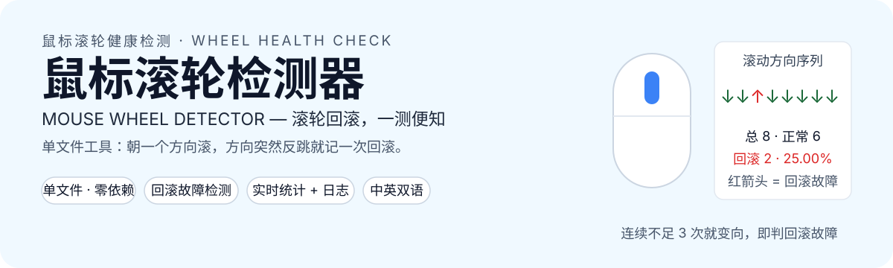
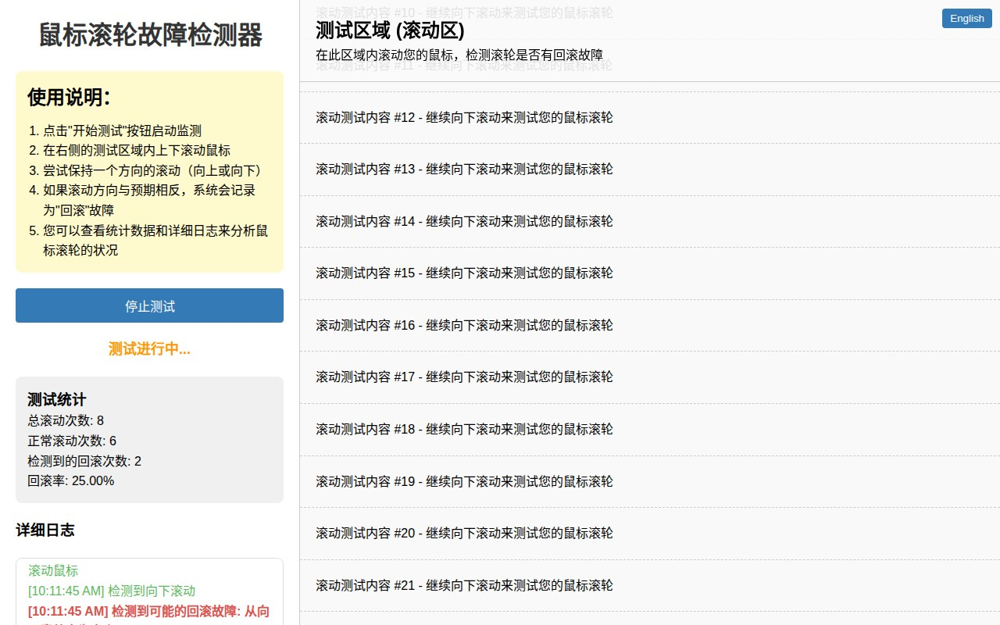

<p align="right"><a href="README.md">中文</a></p>

<p align="center">
  
</p>

<p align="center">
  <a href="https://xiaosang.cc/mouse-scroll-heath-check/">▶ Live Demo</a>
  ·
  <a href="https://holynova.github.io/mouse_scroll_heath_check/">GitHub Pages</a>
  ·
  <a href="https://github.com/holynova/mouse_scroll_heath_check">GitHub Repository</a>
</p>

Mouse Wheel Malfunction Detector is a single-file web tool that detects mouse wheel backscroll faults: when a wheel wears out, scrolling in one direction occasionally jumps back the other way. This tool records every bounce and computes a backscroll rate, so you can tell whether the wheel is really failing.

## Screenshot

<p align="center">
  
</p>

## How to Use

1. Click 「开始测试」 ("Start Test") to begin monitoring.
2. Scroll up and down in the test area on the right, trying to keep one direction (up or down).
3. If the scroll direction flips against expectations, the system records a 「回滚」 ("backscroll") fault.
4. Check the stats and detailed log on the left to judge the wheel's condition.

## Detection Rule

- When the direction changes, look at how many consecutive scrolls went the previous way:
  - **Fewer than 3 consecutive scrolls before the change** → counted as a backscroll fault (red log entry, added to the backscroll count).
  - **3 or more consecutive scrolls before the change** → treated as a deliberate direction change by the user, counted as normal.
- This distinction exists so intentional direction changes are not misread as faults.

## Features

- **Live stats**: total scrolls, normal scrolls, backscrolls, and backscroll rate (to two decimal places).
- **Detailed log**: every entry is timestamped; normal scrolls are logged once per 5 consecutive events to avoid spam, while every backscroll fault is logged.
- **Infinite-scroll test area**: content on the right is generated automatically, so there is always more to scroll.
- **Bilingual**: a button in the top-right corner switches the UI and log between 中文 and English.
- **Single file, zero dependencies**: the whole tool is one `index.html` (~20KB) — no build, no dependencies, no backend, and nothing leaves the browser.

## Run Locally

Just open `index.html` in a browser, or start a static server:

```bash
python3 -m http.server 8000
# Open http://localhost:8000
```

## Tech

- Vanilla HTML / CSS / JS in a single file; listens for `wheel` events in the test area and uses the sign of `event.deltaY` to tell the scroll direction.
- The detection logic lives in the inline script in `index.html`: `lastDirection` tracks the previous direction, `consecutiveCount` tracks consecutive same-direction scrolls, and `stats` (total / normal / abnormal) updates the page in real time.
