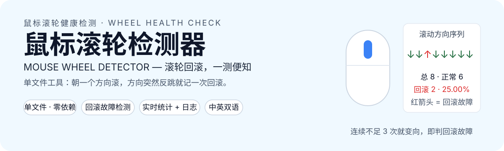
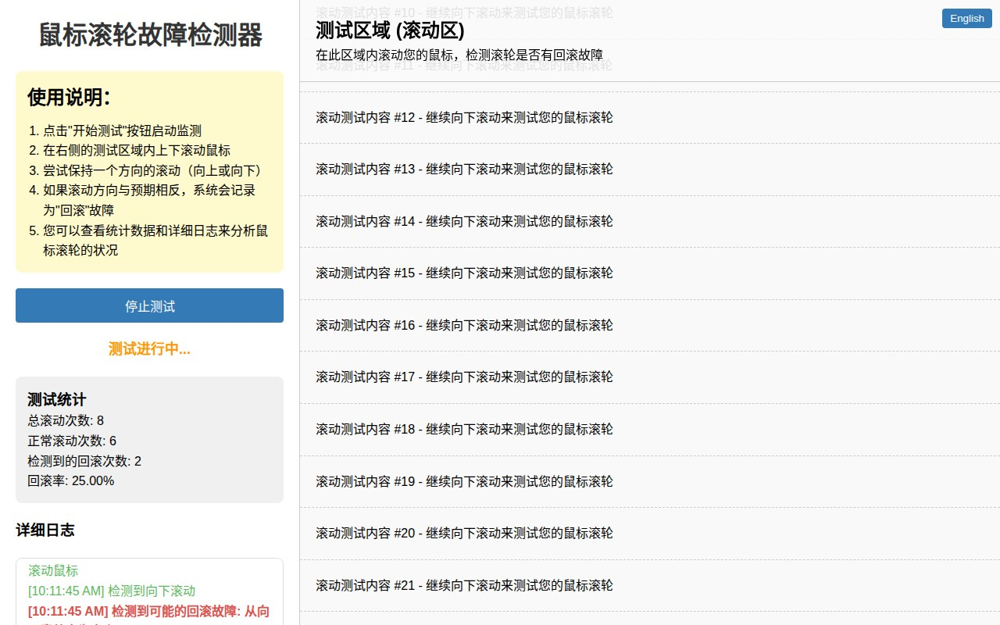

<p align="right"><a href="README.en.md">English</a></p>

<p align="center">
  
</p>

<p align="center">
  <a href="https://xiaosang.cc/mouse-scroll-heath-check/">▶ 在线体验</a>
  ·
  <a href="https://holynova.github.io/mouse_scroll_heath_check/">GitHub Pages</a>
  ·
  <a href="https://github.com/holynova/mouse_scroll_heath_check">GitHub 仓库</a>
</p>

鼠标滚轮故障检测器是一个单文件网页工具，检测鼠标滚轮的回滚故障：滚轮老化或积灰后，朝一个方向滚动时页面会突然反跳一下——这个工具能把每一次反跳都记录下来，算出回滚率，帮你判断滚轮是不是真的坏了。

## 截图

<p align="center">
  
</p>

## 使用

1. 点「开始测试」启动监测。
2. 在右侧测试区域内上下滚动鼠标，尽量保持一个方向（向上或向下）。
3. 如果滚动方向与预期相反，系统会记录为一次「回滚」故障。
4. 看左侧统计与详细日志，判断滚轮状况。

## 判定规则

- 方向改变时，看改变前同一方向的连续滚动次数：
  - **连续不足 3 次就变向** → 判为回滚故障（红色日志，计入回滚次数）。
  - **连续 3 次及以上再变向** → 视为用户主动改变方向，记为正常。
- 这样区分是为了不把你自己有意换向误判成故障。

## 功能

- **实时统计**：总滚动次数、正常次数、回滚次数、回滚率（保留两位小数）。
- **详细日志**：每条记录带时间戳；正常滚动每连续 5 次记一条，避免日志刷屏；回滚故障每条都记。
- **无限滚动测试区**：右侧内容自动生成，滚多少都有内容。
- **中英双语**：右上角按钮切换中文 / English，界面与日志一起切换。
- **单文件零依赖**：整个工具只有一个 `index.html`（约 20KB），无构建、无依赖、无后端，数据不出浏览器。

## 本地运行

直接用浏览器打开 `index.html` 即可；或起一个静态服务器：

```bash
python3 -m http.server 8000
# 打开 http://localhost:8000
```

## 技术

- 原生 HTML / CSS / JS 单文件；监听测试区域的 `wheel` 事件，用 `event.deltaY` 的正负判断滚动方向。
- 判定逻辑在 `index.html` 的行内脚本里：`lastDirection` 记录上次方向，`consecutiveCount` 记录连续同向次数，`stats`（total / normal / abnormal）实时更新到页面。
